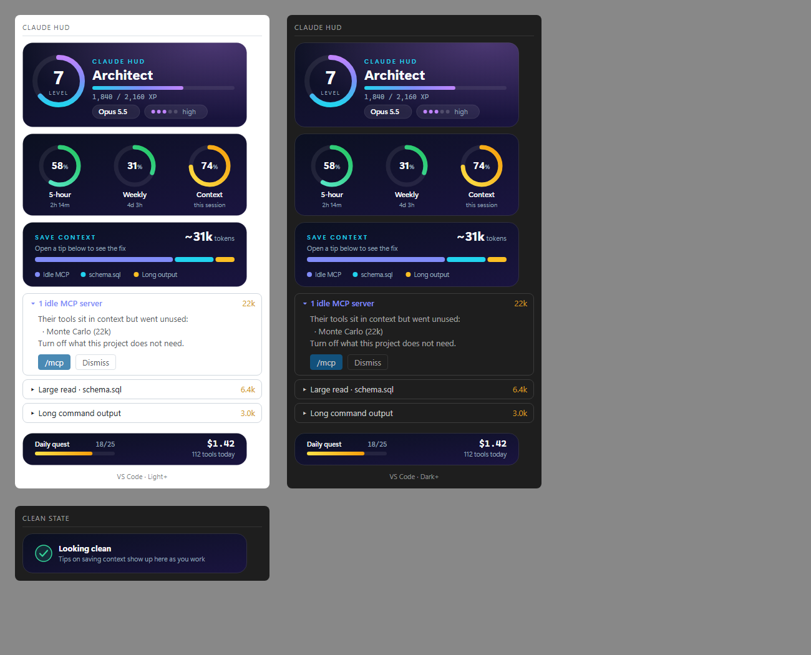

# Claude HUD

A clean heads-up display for Claude Code that also helps you spend less context.

It docks a pane beside the chat and adds a line to the status bar.

In **VS Code, the desktop app and mobile**, the pane draws graphic cards: a level ring, usage gauges, a stacked waste bar and a daily-quest strip. The cards bring their own dark theme, so they look the same in light and dark editor themes.



In the **terminal**, it draws the same information as clean text:

```
 Claude HUD                      Lv 7
 Architect · 1,840 / 2,160 XP
 ████████████████████████░░░░░░░░░░░░

 Model    Opus 5.5
 Effort   high · 3/5

 5-hour   ███████████░░░░░░░░░   58%
          resets in 2h 14m
 Weekly   ██████░░░░░░░░░░░░░░   31%
          resets in 4d 3h
 Context  ███████████████░░░░░   74%
 ────────────────────────────────────
 Save context             ~31k tokens
 ▾ 1 idle MCP server              22k
     Their tools sit in context but
     went unused:
       · Monte Carlo (22k)
     Turn off what this project does
     not need.
     [ /mcp ]  [ Dismiss ]
 ▸ Large read · schema.sql       6.4k
 ▸ Context 74% full                 !
 ────────────────────────────────────
 Quest 14/20 · 112 tools · $1.42
```

## What it shows

- **Model and effort**, live as you switch.
- **Usage limits**: 5-hour and weekly, with reset countdowns. Bars turn amber at 60% and red at 85%.
- **Context fill** for this session.
- **Level, XP and a daily quest**: XP for work done, never for waste. See below.

## Save context: the waste detector

The pane watches what goes into your context window and lists the biggest waste first, with an estimate of the tokens you'd get back. Select a tip to open it:

| Tip | When it shows | What it offers |
| --- | --- | --- |
| **Idle MCP servers** | A connected server's tools take up context and none were called this session | **/mcp**, to turn it off |
| **Large read** | A whole file of over ~2k tokens was read | A link to the file, and a project rule: search with Grep, read line ranges |
| **Read N×** | The same file was read 2 or more times | A link to the file, and a rule to summarize once |
| **Long tool output** | Any tool (Bash, Grep, WebFetch, an MCP tool) returned over ~2k tokens | A rule to narrow searches and pipe output through `head`, `tail` or `grep` |
| **Heavy memory** | A CLAUDE.md or other memory file is over ~2k tokens, paid on every request | A link to the file, and a ready-made prompt to trim it |
| **Large skill listing** | Skill descriptions take over ~3k tokens on every request | **/plugin**, to disable what this project does not use |
| **Context N% full** | The window is over 50% full | **/compact** and **/context** |

Below the tips, **Where your context goes** lists the five biggest parts of the window, as `/context` counts them, so there is always something to read even when no tip fires.

Action buttons put the command or rule into your prompt box. Nothing runs until you press Enter. **Dismiss** hides a tip for the rest of the session. When a tip clears up on its own, for example after you turn off a server or compact, you get +25 XP.

Token counts are estimates: about 4 characters per token. MCP tools that load on demand (tool search) aren't counted, since they don't take up context until they're used.

## Levels: spend tokens on work, not on nothing

Using tokens is fine; tokens that do nothing are the waste. XP follows that rule:

| What happened | XP |
| --- | --- |
| An edit or write that worked | +3 |
| A command that worked, a line-range read, a Grep or Glob search | +2 |
| Any other tool call that worked | +1 |
| A finished turn | +5 |
| A waste tip cleared (unused context freed) | +25 |
| A failed call, a whole-file read over ~2k tokens, a re-read, a huge output | 0 |

The **daily quest** is 20 useful actions a day: edits and commands that worked, none of them waste. Ranks go Novice, Apprentice, Coder, Hacker, Architect, Wizard, Archmage, Legend, one every 3 levels.

## Install

```
/plugin install level-up-hud --marketplace nimrodfisher/claude-data-mods
```

Answer `y` to add the marketplace, then pick the **user** scope. Run `/hud` to reopen the pane at any time.

The pane docks beside the chat in the terminal's fullscreen layout. A pane that opens on its own needs a terminal about 110–144 columns wide. In VS Code, run `claude` in a wide integrated terminal.
